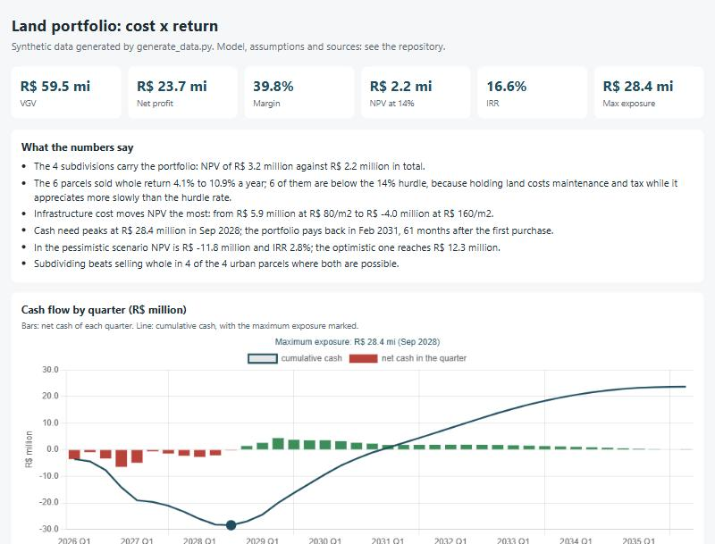

# land-deals-automation

A model that tells a land developer whether each plot is worth buying, whether to split it into lots or sell it
whole, how much cash the business will need before money comes back, and when it comes back.


## Why it matters

Land development ties up money for years: you buy the land, pay for approvals, streets, water and power, and only
then start selling, often in monthly installments. A deal that looks profitable on paper can still be a bad use of
money if the cash comes back too slowly. This model puts every cost and every payment on a monthly calendar, so
that question has a number.

## Results

For a made-up portfolio of 10 plots (full report: [`final-report.pdf`](final-report.pdf)):

| | Expected case | Bad case | Good case |
|---|---|---|---|
| Total sales | R$ 59.5 million | R$ 50.4 million | R$ 65.6 million |
| Value created, after a 14% a year required return | R$ 2.2 million | R$ -11.8 million | R$ 12.3 million |
| Return per year | 16.6% | 2.8% | 31.5% |
| Most cash tied up at one time | R$ 28.4 million | R$ 39.9 million | R$ 20.4 million |
| Months until the money is back | 61 | 99 | 44 |

- Splitting the large plots into lots is what makes money. The six plots resold whole earn less than the 14%
  required return: holding land costs upkeep and property tax every month, and the land gains value more slowly.
- The cost of building streets and utilities moves the result more than anything else.



## Run it

```
pip install -r requirements.txt
python demo.py
```

Runs without an API key, replaying recorded answers. Set `ANTHROPIC_API_KEY` to call Claude live.

It writes `final-report.pdf` and, in `output/`, an Excel workbook, a dashboard page (`dashboard.html`) and the
investment notes for each plot. Tests: `python -m pytest -q`. Day-to-day use and what to do when something
breaks: [`RUNBOOK.md`](RUNBOOK.md).

## How it works

1. **Split or sell whole.** Large urban plots are split into lots; small and rural ones are sold whole. The
   workbook shows both options for every urban plot, so the rule can be challenged.
2. **Costs, month by month.** Purchase taxes and registry, upkeep and property tax while the land is unsold, and
   for lots: surveys and approvals, streets and utilities, marketing, sales commission and taxes on sales.
3. **Sales and payments.** Lots sell over about three years. Buyers pay part in cash and part in monthly
   installments with interest, adjusted for inflation once a year; a small share is never paid.
4. **Results.** Value created, return per year, cash tied up, months to get the money back, with a bad, an expected
   and a good case, and a chart of which assumption changes the answer most.
5. **AI where it helps.** Claude reads a plot description written in plain Portuguese ("12 hectares, should close
   at R$ 3.8 million...") and fills in the model's inputs, which a person confirms. It also writes a short
   investment note per plot; the code rejects any note that quotes a number the model did not compute.
6. **Checked twice.** A separate calculation rebuilds three plots from scratch and must match the model.

Every assumption (tax rates, building costs, sales speed, interest) is in `land_deals/config.py`, with a range and
where it comes from: the law that sets it, or "illustrative" when it is a typical value.

## Data

All data is synthetic, generated by `generate_data.py`: the plots, towns, prices and the three plot descriptions in
`data/intake/` are invented. No real company, client or deal is used.

## Limits

- Illustrative costs are typical values, not quotes; a real decision needs real budgets and local lot prices.
- Lots sell at an even pace; there is no launch rush or real sales history.
- Inflation is a fixed yearly rate, not the published index. Cancelled sales and mixed plans (split part of a plot,
  sell the rest) are not modelled.

## How AI was used

I use Claude (Claude Code and the API) for coding, review and documentation. The questions, modelling choices,
validation and conclusions are mine. In the product, the smallest Claude model reads plot descriptions and writes
the investment notes, with a limit on calls per run; every answer is saved, so the same question is never paid twice.

MIT License.
