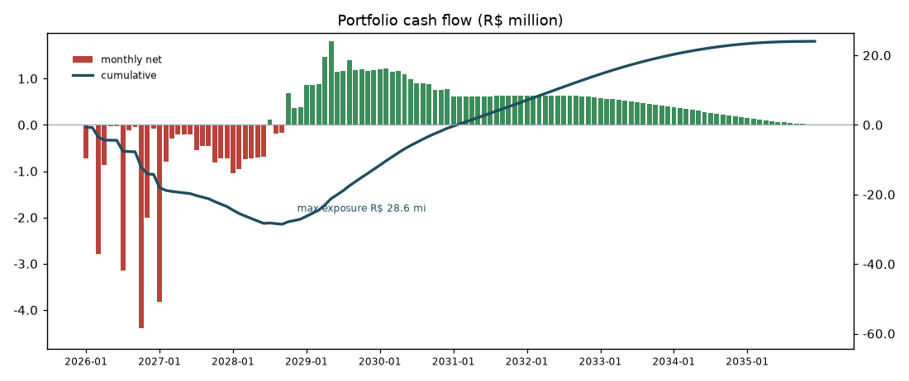

# land-deals-automation

Cost x return model for a portfolio of land parcels. For each parcel it decides whether to subdivide it into lots
(loteamento) or resell it whole, projects every cost and receipt month by month, and computes VGV, NPV, IRR,
payback, margin and the maximum cash the business has to put in. It then runs scenarios and a sensitivity
analysis and publishes the results as an Excel workbook, a static HTML dashboard and a PDF report.

Claude is used in two places where it adds something a formula cannot: it turns a free-text description of a new
parcel into structured premises (which a person confirms), and it writes an investment memo per parcel, in which
every number is checked against the model before the memo is kept.

All data is synthetic, generated by `generate_data.py`.



## Quickstart

```
pip install -r requirements.txt
python -m land_deals demo          # no API key needed: replays the recorded answers
python -m pytest -q                # offline tests
```

Outputs:

| File | What it is |
|---|---|
| `output/land_portfolio.xlsx` | Summary, Assumptions (with sources), Parcels, Costs, Cash flow, Sensitivity, Strategy, Memos, with charts |
| `output/dashboard.html` | static dashboard (Chart.js); works on GitHub Pages |
| `reports/final-report.pdf` | summary page and the four main charts |
| `reports/memos.md`, `reports/summary.json`, `reports/charts/*.png` | memos, headline numbers, charts |

Other commands:

```
python generate_data.py                                    # data/portfolio.json
python -m land_deals run [--no-memos]                      # model + outputs (memos need a key or recordings)
python -m land_deals intake data/intake/gleba-12ha.txt     # free text -> premises, shown for confirmation
python -m land_deals intake data/intake/gleba-12ha.txt --accept   # adds the parcel to the portfolio
```

To run live, put `ANTHROPIC_API_KEY` in the environment or in `.env` (see `.env.example`).

## The model

Ten fictitious parcels: three urban-expansion plots (glebas) and one urban plot that are big enough to subdivide,
four smaller urban areas and two rural small farms that are resold whole. Rule (a parameter): urban or
urban-expansion parcels of at least 20,000 m2 are subdivided; everything else is sold whole. The `Strategy` sheet
shows both options for every urban parcel, so the rule can be questioned.

| Stage | Costs and receipts |
|---|---|
| Acquisition | price, ITBI, deed and registry; CAR surveyor's fee for rural parcels |
| Holding | cleaning and maintenance per m2 of unsold area; IPTU (urban) or ITR (rural) on the land value, until sold |
| Subdivision | topography and approval projects over the approval period; streets, drainage, water, sewage and power plus site labor over the works period; fence and gatehouse; marketing |
| Sales | lots sold evenly over an absorption period (36 months base, 24 to 48), or the whole parcel after a holding period with land appreciation; broker fee; taxes on receipts (Lucro Presumido) |
| Receipts | part cash, part financed: down payment plus Price-table installments with monthly interest, corrected yearly by a fixed IPCA assumption, net of a small default rate |

Every assumption sits in `land_deals/config.py` with a base value, a low and a high value, a unit and a source.
Public rules are cited (ITR rates from Lei 9.393/1996, presumed-profit taxes from Lei 9.249/1995 and
Lei 9.718/1998, subdivision under Lei 6.766/1979); everything else is marked illustrative. The low and high values
drive the scenarios and the sensitivity analysis. A parcel can override any assumption in `data/portfolio.json`.

Metrics per parcel and for the portfolio: VGV, nominal profit, margin on VGV, NPV at the hurdle rate (14% a year
base), IRR, payback, maximum cash exposure and when it happens, ROI per year.

Base case on the synthetic portfolio (`reports/summary.json`):

| Portfolio | Base | Pessimistic | Optimistic |
|---|---|---|---|
| VGV | R$ 59.5 million (52.2 subdivided, 7.3 sold whole) | R$ 50.4 million | R$ 65.6 million |
| Net profit, margin on VGV | R$ 24.0 million, 40.4% | R$ 5.2 million, 10.3% | R$ 36.1 million, 55.0% |
| NPV at 14% a year | R$ 2.3 million | R$ -11.9 million | R$ 12.5 million |
| IRR per year | 16.7% | 2.8% | 31.7% |
| Maximum cash exposure | R$ 28.6 million (Sep 2028) | R$ 40.1 million | R$ 20.5 million |
| Payback | Feb 2031 (month 61) | month 98 | month 44 |

What the model says about this portfolio:

- The four subdivisions carry it. The six parcels sold whole return 4% to 10% a year, below the 14% hurdle, even
  bought 10% to 30% below market: holding land costs maintenance and tax while appreciation is slower than the
  hurdle rate.
- Infrastructure cost and lot price move NPV the most: R$ 80 to R$ 160 per m2 of infrastructure swings it from
  R$ 6.0 million to R$ -3.8 million.
- For every urban parcel big enough, subdividing beats selling whole (`Strategy` sheet).
- The cash need peaks at R$ 28.6 million in month 32 (Sep 2028) and is only recovered in month 61: this is the "return
  takes 2 to 4 years" of the business, in numbers.

## Where the AI is used

| Step | What Claude does | What Python checks |
|---|---|---|
| Intake | reads a description such as "Gleba de 12 hectares ... deve fechar em R$ 3,8 milhões" and returns each premise as written, with the passage it came from (JSON Schema) | the passage exists in the text; units are converted by code (hectares, alqueires paulistas, "mil", "milhões"); missing premises get a default and are flagged; nothing enters the portfolio until a person runs `--accept` |
| Memo | writes a short memo per parcel (recommendation, thesis, risks, conditions) from the list of facts the model computed | every number in the memo must be one of those facts, written the same way; a negative NPV cannot be "invest". A memo that fails is retried once with the complaints, then dropped |

Both use `claude-haiku-5-5` with structured output. The free-text examples are in `data/intake/`.

## Cost controls

| Control | Setting |
|---|---|
| Model | `claude-haiku-5-5` (USD 0.10 / 0.50 per million input / output tokens), thinking disabled, effort low |
| Output budget | 900 tokens per intake or memo; a truncated answer is retried once with 1.5x |
| Call cap | `LAND_MAX_CALLS`, default 20 per run |
| Response cache | every accepted answer is saved in `recordings/` (versioned); an identical request is never paid twice, and without a key the recordings replay the run |
| Timeouts and retries | 60 s timeout, 2 SDK retries for network errors, 1 retry when the checks fail |
| Log | one JSON line per call in `logs/` (not versioned), with tokens and estimated cost |

**Measured cost.** The recordings come from one live run: 13 calls (3 intakes, 10 memos), 11,095 input and 5,504
output tokens, about **USD 0.004**. All 10 memos passed the number check on the first attempt. An earlier
version of this repository (document extraction, since replaced by this cost x return model) used 52 calls,
about USD 0.04.

## Layout

```
land_deals/
  config.py      assumptions with ranges and sources, model and limits
  synthetic.py   the fictitious portfolio
  model.py       monthly cash flow per parcel, NPV, IRR, payback, exposure; portfolio, scenarios, sensitivity
  intake.py      AI intake: free text -> premises, unit conversion, validation
  memo.py        AI memo and its number check
  llm.py         API wrapper: recordings, call cap, retries, logging
  workbook.py    Excel output (openpyxl)
  charts.py      PNG charts, PDF report, HTML dashboard
data/            portfolio.json, intake examples
recordings/      recorded LLM answers (versioned)
output/          workbook and dashboard
reports/         final-report.pdf, memos.md, summary.json, charts
tests/           pytest, no network
```

## Limitations and next steps

- Assumptions marked illustrative are typical values, not market research; the model is a decision aid to be fed
  with real quotes.
- Sales are spread evenly over the absorption period; a launch peak and a real sales curve come next.
- The correction index is a fixed yearly rate, not the real IPCA or IGP-M series. Taxes use the presumed-profit
  regime only; cancellations (distrato) are not modeled.
- Mixed strategies (subdivide part of a parcel and sell the rest whole) are not modeled yet.
